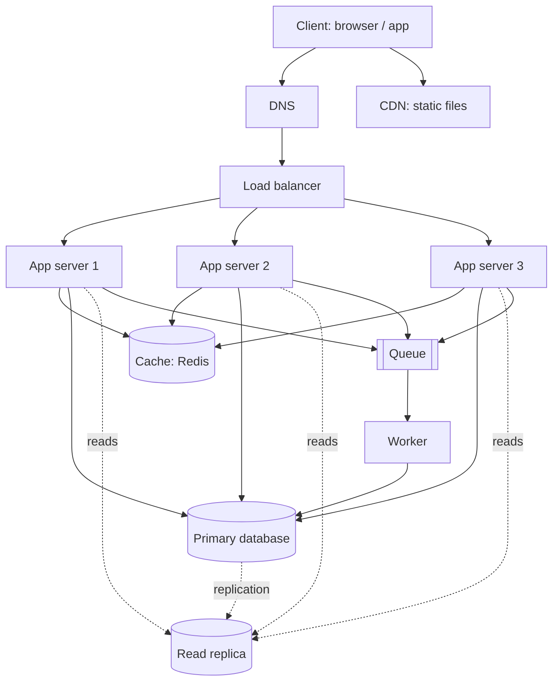

# QuickNotes Architecture

## Requirements

**Functional**
- Register, log in and log out.
- Create, read, update and delete notes.
- Tag notes and filter or search by tag.
- Access notes from any device.

**Non-functional**
- Availability: 99.9% (about 9 hours of downtime per year at most).
- Latency: p95 under 300 ms for reads and writes.
- Durability: no acknowledged note is ever lost (backups, replication).
- Scalability: 1 million users, able to grow 10x by adding servers.
- Security: HTTPS everywhere, hashed passwords, users see only their own notes.

## Estimates (1 million users)

Assumptions: 20% are active daily (200,000 DAU); each active user reads notes 30 times and writes 5 times per day; peak traffic is 5x average.

| Metric | Calculation | Result |
|--------|-------------|--------|
| Reads per second | 200,000 x 30 = 6M/day / 86,400 | ~70 avg, ~350 peak |
| Writes per second | 200,000 x 5 = 1M/day / 86,400 | ~12 avg, ~60 peak |
| Storage per year | 1M notes/day x 365 x ~1 KB | ~365 GB (~0.7 TB with indexes) |

The load is read-heavy (about 6:1), so caching and read replicas pay off. Peak numbers are comfortable for a few app servers and one database primary.

## Diagram

## Components

- **Client:** shows the UI and calls the API over HTTPS, so users get a fast interface on any device.
- **DNS:** turns `quicknotes.example` into the address of the nearest entry point, so users need no IP address and we can move servers without them noticing.
- **CDN:** serves HTML, CSS and JS from locations close to users, which cuts latency and keeps static traffic off our servers.
- **Load balancer:** spreads requests across app servers and removes unhealthy ones, so no single server is overloaded or a single point of failure.
- **App servers (3, stateless):** run the API logic and can be added or removed freely because they keep no session state (tokens are self-contained).
- **Cache (Redis):** keeps hot data such as each user's first page of notes in memory, so most reads skip the database.
- **Primary database (PostgreSQL):** the single source of truth that accepts all writes and guarantees consistency.
- **Read replica:** a continuously updated copy that serves read queries and takes over if the primary fails, spreading load and improving durability.
- **Queue:** buffers slow background jobs (search indexing, tag counts, emails) so API requests return immediately and traffic spikes are absorbed.
- **Worker:** takes jobs from the queue and runs them at its own pace, keeping slow work out of the request path.

## Request flows

**GET /v1/notes**
1. Client resolves the domain through DNS and sends the HTTPS request.
2. The load balancer picks a healthy app server.
3. The app server validates the token and identifies the user.
4. It checks the cache with key `notes:{userId}:page1`.
5. Cache hit: return the cached JSON. Cache miss: query a read replica (indexed by `user_id, created_at`).
6. It stores the result in the cache with a 60 s TTL and returns `200 OK` with the list.

**POST /v1/notes**
1. Client sends the request through DNS and the load balancer to an app server.
2. The app server validates the token and the body (title 1-100 characters).
3. It writes the note and its tags to the primary database in one transaction.
4. It deletes the user's cached note pages (`notes:{userId}:*`) so the next read is fresh.
5. It publishes a `note.created` job to the queue (search index, stats).
6. It returns `201 Created` with the new note; a worker later processes the job.

## Trade-offs

1. **Cache freshness vs speed.** Caching makes reads fast, but data can be stale. We invalidate on every write and use a short TTL; a replica can also lag by milliseconds, so right after a write we read from the primary for that user.
2. **Consistency vs availability with replicas.** Asynchronous replication keeps writes fast but risks losing the last few milliseconds of writes if the primary dies. We accept this for notes, and use synchronous replication only if the business requires zero loss.
3. **Queue adds complexity for faster responses.** Background work means eventual consistency (a new note may take seconds to appear in search) and extra infrastructure to monitor, but it keeps request latency low.
4. **Simplicity vs scale.** One primary database is simple and enough for ~60 writes/s. If writes grow 100x, we shard by `user_id` at the cost of more operational work.

## Avoiding single points of failure

- **DNS and CDN:** managed providers with multiple global locations.
- **Load balancer:** run as a redundant pair (active-active or with failover IP).
- **App servers:** three or more across availability zones; any one can fail.
- **Cache:** Redis with a replica and automatic failover; if it is down, the app falls back to the database, only slower.
- **Database:** the read replica is promoted to primary automatically on failure, plus daily backups and point-in-time recovery.
- **Queue and worker:** the queue is replicated and persistent; run two or more workers, and jobs are retried and idempotent, so nothing is lost if a worker dies.